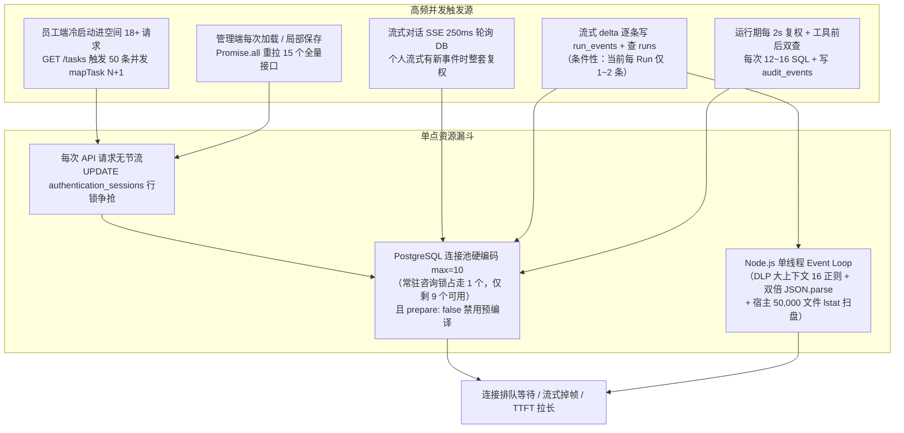

# dsh-work 架构合理性、过度设计与性能全面审核报告

**状态：** 已逐项对照源码核实；第 1 节靶点与 2.0 速览表已按阶段零第一批实测（2026-11-28）校准，执行计划与浏览器侧指标待补测 
**审核日期：** 2026-11-27（对照 `main` 分支 `13382749`，含 `RP-S2` #180 / `RP-S3` #181） 
**审查范围：** 全仓源码与迁移文件、138 个 PostgreSQL 迁移文件（0039 有两个）、约 12 万行非测试业务代码、双端构建产物（`dist/`）及 CI / 脚本工具链 
**关联文档：** [架构总览](../development/overview.md)、[Runtime 执行架构渐进优化方案](runtime-execution-optimization-plan.md)、[数据模型](data-model.md)、[开发与测试](../development/development.md)

> **核实与使用说明**
>
> 1. 本文所列代码机制与构建产物数据已对照 `main`（`13382749`）源码逐项核实；涉及 PostgreSQL 优化器行为的查询（如 `UNION ALL` 分支下推）仍需以真实数据上的 `EXPLAIN` 为准。
> 2. 文中涉及的调用次数与 SQL 条数（如“单请求 500+ SQL”、“每秒 ~20～24 SQL”）均为**按代码分支推算的静态上限，尚未经过真实负载压测**。
> 3. 鉴于目标部署形态为**单企业内网、单台 Mac mini**，并发度远低于公网 SaaS，立项改造前应先通过 [database.ts](../../server/src/infrastructure/postgres/database.ts#L15) 的 `debug` 查询计数钩子与 `pnpm report:run-timings` 采集真实基线，按实测收益排定优先级，不做无数据支撑的重构。
> 4. 阶段零第一批实测见[本机实测基线](architecture-audit-baseline-2026-11-28.md)：当前 DSH 每个 Run 只有 1～2 条 `assistant.delta`（按整段提交、非逐 Token），据此调整了第 1 节、2.0 速览表与各条目的“阶段零实测”注记；第 2 节正文保留原推算以便对照。

---

## 1. 总体结论与三大根因诊断

`dsh-work` 的安全边界意识、权限严密性和自动化测试覆盖度很高，但在多轮迭代演进中出现了明显的**“部署形态错配”**与**“评审驱动型防御堆叠”**。在几十人内网日常低并发下多数锁竞争不会立即报错，但在**多人同时打开工作台、长回答流式输出、多步工具调用及历史表持续累积**时，存在明确的资源瓶颈与体感延迟。

核心问题归结为三大根因：

1. **单机单进程部署，却把 PostgreSQL 当作高频实时消息队列与轮询源**：[架构总览](../development/overview.md) 明确限定为单节点进程内运行（Mac mini 模块化单体），但实现中几乎不使用进程内内存订阅（`EventEmitter`）与写时失效缓存，导致流式回复逐片段写库、SSE 每 250ms 轮询数据库、每次只读请求都无节流 `UPDATE` 会话表；而**数据库连接池硬编码锁死在 `max: 10`（被常驻咨询锁占走 1 条后实际仅剩 9 条可用连接）**。
2. **防御性检查层层叠加在请求与流式热路径上**：每修补一处边缘竞态，就在热路径上叠加一层父表排他锁（`workspaces FOR UPDATE`）、一层 12～16 条 SQL 的无缓存复权（甚至每 2 秒往审计表写一行 `success`），或一次全目录 `lstat` / 全包 SHA-256 重算。
3. **工程护栏异化为高昂的“手工同步税”**：手写 18,691 行 OpenAPI JSON（却既不校验 Schema 也不生成客户端类型）、维护 4,000+ 行平行内存假后端、零跨端复用的前端强行拆包、CI 单任务串行冷启动 12 套 E2E 环境，显著拉高了日常需求改动的摩擦成本。

在单机 Mac mini 场景下，按阶段零实测，**真正影响日常体感与稳定性的高价值靶点集中在 4 处**：
1. `GET /tasks` 的仓储层 `listTasks` 在 50 个 Run 时实测 **501 条 SQL**（不含路由层 `attachListRoles` 对每个 Run 的空间读权限复核，整个接口更多），单个请求即占满仅有的 **9 条可用连接**，同时刻的其他请求、SSE 轮询与事件落库只能排队；
2. 运行期每 2s 复权并向 `audit_events` 写 `success`：实测占审计表 **76%**、按已完成 Run 计约 **31 行/Run**（按全部 Run 约 29 行），是审计表增长的主因；
3. 每个打开的运行流 SSE 每 250ms 轮询（约 8 条 SQL/秒/流）+ 每次 API 请求无节流 `UPDATE authentication_sessions`（每请求 3 条 SQL）；
4. 双端首屏 **1.1 MB JS 包** + 外部模型网关请求体双重解析与 DLP 零缓存 + WeKnora 检索同步阻塞 `POST /runs` 202 返回（这三项的实际耗时待浏览器与真实运行补测）。

流式 `assistant.delta` 逐片段落库与前端逐 delta 重解析 Markdown 在当前 DSH 下不成立（每个 Run 只有 1～2 条整段 delta），降为**条件性风险**：DSH 改为逐 Token 流式时再处理。

---

## 2. 核心性能瓶颈清单

### 2.0 关键瓶颈速览表（按阶段零实测校准，2026-11-28）

| 优先级 | 领域 | 问题简述 | 量级（实测 / 推算） |
| :--- | :--- | :--- | :--- |
| **高优** | 数据库连接池与 N+1 | 连接池固定 `max: 10`（实际可用 9 个）且 `prepare: false`；`GET /tasks` 50 条并发 `mapTask` | **实测** 仓储层 `listTasks` 50 个 Run = **501 条 SQL**（不含路由层逐 Run 复权），单个请求占满 9 条连接；连接池 9 条时并发 5 个约 0.5 秒 |
| **高优** | 运行期复权与审计膨胀 | 运行中每 2s 轮询 + 工具调用前后双查，每次 12～16 条 SQL 并向 `audit_events` 插入 `success` | **实测** 成功审计占 `audit_events` **76%**、按已完成 Run 计约 **31 行/Run**；**推算** 每天 1,000 个 Run 时审计表约 1 GB/月 |
| **高优** | 前端包体积 | 双端全量打包 Element Plus，未配置按需加载与 `manualChunks` | **实测** 双端首屏单 JS chunk 均为 **1.1 MB**（另加 **380+ KB** CSS）；首屏加载耗时待浏览器补测 |
| **中优** | SSE 轮询与鉴权写放大 | 无内存 PubSub，SSE 每 250ms 轮询 PG；每次只读 API 请求均无节流 `UPDATE authentication_sessions` | **实测** 单次轮询 2 条 SQL、`authenticateApi` 3 条 SQL；**推算** 约 8 条 SQL/秒/运行流（原推算 20～24）；团队空间会话流待补测 |
| **高优（待补测）** | 模型网关与 DLP | 请求体双倍 `JSON.parse`、SSE 每帧多余 `JSON.parse`；外部路由每步在主线程无缓存编译词表跑最多 16 个全局正则 | 主线程耗时待真实运行补测，补测前维持原优先级；**实测** 本机每个 Attempt 输入 Token p50 / p95 为 9,160 / 22,505（见基线 2.7） |
| **中优** | 同步阻塞：知识库检索 | `POST /runs` 返回 202 前同步等待 WeKnora 检索（含 fallback） | 个人对话带知识库时最坏 **2 次检索超时（单次默认 10s，合计 20s）**；实际耗时待补测 |
| **中优** | 慢查询与大 JSONB 解压 | 多处多表笛卡尔乘积；`operational_events` 全量并入 `run_events` 做文本 `ilike`；统计逐行解压 `manifest` JSONB | **实测** `manifest` p50 5.2 KB、p95 13 KB；执行计划待一次性库造量后 `EXPLAIN` |
| **低优** | 首字延迟（TTFT） | 每轮冷启动 DSH 子进程；同一 Skill 包读盘算哈希 3 次 | **实测** 冷启动 p50 约 1.2 秒，约占端到端 p50（23.7 秒）的 5%；按基线维持阶段三按需评估。Skill 包重复读取未单独测量 |
| **中优（待补测）** | 容器扫盘 | 每条容器命令前/中/后在宿主递归 `lstat` 工作区（上限 50,000 条目） | 未测量；大工作区高频命令时的线程池占用待补测 |
| **低优** | 同步阻塞：成果解析 | `run.completed` 前同步等成果解析容器 | **实测** 成果收集 p95 0.6 秒、最大 0.9 秒（60 秒是超时上限） |
| **条件性** | 流式事件持久化 | `assistant.delta` 逐条 `INSERT run_events`，写后复查每条执行 `SELECT runs`；`run_events` 重复索引 | **实测** 每个 Run 仅 1～2 条 delta（p95 2、最大 7）；DSH 改为逐 Token 流式时才会放大。重复索引仍建议删除 |
| **条件性** | 前端流式渲染 | 每个 delta 触发全量 Markdown 重解析与历史消息重渲染 | 同上：每个回答 1～2 次重解析，当前无掉帧依据 |

---

### 2.1 数据库连接池、鉴权写放大与超级 N+1

1. **连接池硬编码 `max: 10`（实际仅 9 个可用）且禁用预编译缓存**
   - **代码位置**：[database.ts](../../server/src/infrastructure/postgres/database.ts#L18-L27)、[main.ts](../../server/src/main.ts#L167)、[automation-trigger-sweep.ts](../../server/src/modules/automation/automation-trigger-sweep.ts#L55-L64)
   - **机制分析**：`createDatabase()` 默认 `max: configuration.maxConnections ?? 10`、`prepare: false`（禁用 PostgreSQL Prepared Statement 执行计划缓存），且未设置 `statement_timeout` 或 `lock_timeout`；`main.ts` 调用时未接入任何环境变量或配置项。同时 `AutomationTriggerSweep.start()` 通过 `database.reserve()` 永久借走 1 条连接持有会话级 `pg_try_advisory_lock`，导致全进程所有 HTTP 请求、SSE 轮询、流式落库与后台清扫共同争抢仅剩的 **9 条连接**。

2. **每次 API 请求零缓存查库 + 100% 无节流同步 `UPDATE authentication_sessions`**
   > **阶段零实测**：本地账号会话 `authenticateApi` = 3 条 SQL（含 1 条 `UPDATE`），单次约 2～9 ms；钉钉会话多 1 条为推算，未实测。
   - **代码位置**：[local-auth-service.ts](../../server/src/modules/identity/local-auth-service.ts#L213-L273)、[session-repository.ts](../../server/src/modules/identity/session-repository.ts#L27-L89)
   - **机制分析**：
     - 钉钉免登员工每次请求执行 `await this.findLocalSession(...) ?? await this.findDingTalkSession(...)`（L223），每次先白跑一遍本地账号 4 表 JOIN 落空，再跑 5 表 JOIN；
     - `resolveAuthorization`（L232）每次做 6 表关联并展开 `jsonb_array_elements_text(r.permissions)` 与 `data_scope_grants` 乘积后做 4 个 `array_agg(distinct ...)`；
     - L234 **无任何时间间隔或版本号节流**，同步执行 `UPDATE authentication_sessions SET authorization_version = ..., last_seen_at = now()`。所有纯只读 `GET` 请求全部变成写事务，页面首屏并发请求时在同一行 `session_hash` 上争抢行锁，并持续产生 MVCC 死元组与 WAL 刷盘。

3. **路由层重复鉴权与团队 SSE 前置探测 SQL 开销**
   > **阶段零实测**：个人空间 `authorizeWorkbench` = 3 条 SQL（下文“4 条”为原推算）；团队路由前置调用次数未实测。
   - **代码位置**：[postgres-authorization-service.ts](../../server/src/modules/authorization/postgres-authorization-service.ts#L139-L168)（及 L495-551）
   - **机制分析**：
     - `Router` 刚完成 `authenticateApi`，进入业务路由后几乎每个接口又调用 `authorizeWorkbench(...)`，丢弃刚查出的权限再次串行跑 4 条 SQL（团队路由叠加 `readableWorkspaceTypeOf` / `requireTeamRole` 单请求前置达 9～11 次 DB 往返）；
     - 团队 SSE 专用的 `authorizeTeamReadAccess`（L508-548）设有 10 秒内存缓存 `teamReadAccessCache`，命中时可跳过 4 条 SQL 的 `authorizeWorkbench`；但为捕获用户停用、角色权限修改以及**时间触发的角色到期（`user_roles.valid_until > now()`，评审 M5 修复）**，每次读取缓存前仍需先执行 1 条关联 5 张表并计算 `string_agg` + 双重 `md5()` 的探测 SQL。由于时间到期不会产生进程内写事件，不能简单改为“纯内存写时失效”，但可通过简化探测查询或在缓存项内记录最早 `valid_until` 时间戳（配合用户停用/改权主动失效）来降低高频探测成本；无论哪种做法，都须保留现有全部判定：用户与租户仍有效、角色权限指纹、角色到期以及空间状态轨。

4. **`GET /api/workbench/v1/tasks` 50 条并发 `mapTask` 超级 N+1**
   > **阶段零实测**：仓储层 `listTasks` 在 50 个 Run 时共 501 条 SQL（1 + 50 × 10），不含路由层 `attachListRoles` 的逐 Run 复权；`mapTask` 并行执行，单个请求即占满 9 条连接。
   - **代码位置**：[postgres-conversation-repository.ts](../../server/src/modules/workbench/application/postgres-conversation-repository.ts#L948-L977)（及 L1424-1511、L1586-1648）、[conversation-routes.ts](../../server/src/http/workbench/conversation-routes.ts#L510-L515)
   - **机制分析**：`listTasks()` 取出最近 50 条 `runs` 后直接 `Promise.all(rows.map(row => this.mapTask(row)))`。每个 `mapTask` 内部串行跑 8～9 条 SQL（含无 `limit` 拉取整段会话全部历史消息、全量 `run_events`、成果、引用、工具与 MCP 审计——若同一多轮会话有 10 个 Run，整段会话消息被重复查询拷贝 10 遍）；回到路由层 `attachListRoles` 又未按 `workspaceId` 去重并发复核 50 次空间读权限。

---

### 2.2 流式事件落库与 SSE 数据库轮询风暴

1. **`assistant.delta` 逐个 chunk 串行写库 + 写后复查导致逐 chunk `SELECT runs`**
   > **阶段零实测**：当前 DSH 每个 Run 只有 1～2 条 `assistant.delta`（中位 457 字符），下文“每个流式文本片段”的放大在当前版本不发生，降为条件性风险；重复索引仍建议删除。
   - **代码位置**：[dsh-acp-runtime-adapter.ts](../../server/src/modules/runtime/dsh-acp-runtime-adapter.ts#L1266-L1281)、[run-event-recorder.ts](../../server/src/modules/run/orchestration/run-event-recorder.ts#L58-L103)（及 L214-225）、[postgres-run-repository.ts](../../server/src/modules/run/postgres-run-repository.ts#L716-L730)、[0003_m3_conversation_runtime.sql](../../server/migrations/0003_m3_conversation_runtime.sql#L19-L23)
   - **机制分析**：
     - DSH 适配器对每个 ACP 文本片段无缓冲发出一行 `assistant.delta`，`RunEventRecorder` 在单条 Promise 链上对每个片段执行独立 `INSERT INTO run_events`（L95）；
     - L100 的写后复查 `if (await this.isLateEvent(run, event))` 用于拦截已被替代 Attempt 的后续副作用（包括 `CONSEQUENTIAL_EVENTS` 以及不在其中但会在 L214 写审计的 `approval.resolved`），而 `isLateEvent`（L71）第一行无条件执行 `this.deps.runs.getRun(tenantId, run.id)`。由于未提前跳过根本没有后续处理分支的纯展示事件（如 `assistant.delta`），导致**每一个流式文本片段都串行执行 `1 次 INSERT run_events + 1 次 SELECT runs`**；
     - `0003_m3_conversation_runtime.sql` 在 `run_events` 上同时创建了完全同列同序的 `run_events_stream_position_unique (tenant_id, run_id, stream_position)` 与 `run_events_by_run_stream (tenant_id, run_id, stream_position)`，每次流式插入白白双写两棵相同的 B-Tree。

2. **SSE 推送无进程内通知，高频轮询数据库**
   > **阶段零实测**：单次轮询 2 条 SQL、`authorizeWorkbench` 3 条 SQL；轮询本身即约 8 条 SQL/秒/流（每 250ms 2 条）；个人流只在有新事件的批次和每 15 秒心跳时额外复权，每个 Run 约 7 个事件，额外开销很小，下文“~20～24 SQL/s”为高估。
   - **代码位置**：[conversation-routes.ts](../../server/src/http/workbench/conversation-routes.ts#L388-L407)（及 L578-647、L739-743、L851-853）
   - **机制分析**：
     - `streamRunEvents` 不用进程内订阅，每个活跃 SSE 连接在 `while (!closed)` 中每 **250ms** 查一次 `readEventsAfterEvent` + 查一次 `getRun`；个人对话还在 L400-404 传入无缓存的 `personalAccess`（内部调用完整 `authorizeWorkbench`），流式输出期间每 250ms 都有新事件，触发每 250ms 额外执行 3～4 条权限 SQL；
     - 团队空间会话流 `streamWorkspaceSessionEvents` 每 **500ms** 轮询一次，其中 `listRecentlyArchivedSessionIds` 在带 `since` 参数时不走共享快照，按在线成员数线性放大查询。

---

### 2.3 模型网关与数据防护（DLP）主线程 CPU 阻塞与零缓存

- **代码位置**：[model-gateway.ts](../../server/src/modules/model-gateway/model-gateway.ts#L260-L296)、[model-gateway-redaction.ts](../../server/src/modules/model-gateway/model-gateway-redaction.ts#L226-L235)、[data-protection-detectors.ts](../../server/src/modules/data-protection/data-protection-detectors.ts#L114-L199)、[data-protection-masking.ts](../../server/src/modules/data-protection/data-protection-masking.ts#L88-L103)、[data-protection-service.ts](../../server/src/modules/data-protection/data-protection-service.ts#L44-L53)、[postgres-encrypted-credential-store.ts](../../server/src/modules/tool/postgres-encrypted-credential-store.ts#L67-L85)、[document-extractor.ts](../../server/src/modules/workbench/application/document-extractor.ts#L162-L275)
- **机制分析**：
  1. **双重解析浪费**：`model-gateway.ts` L260 `readModel(body)` 把最大 64 MiB 请求体转字符串 `JSON.parse` 一遍只为取 `model`，L286 紧接着再 `JSON.parse` 第二遍；流式响应 `SseResponseRestorer.processEvent`（`model-gateway-redaction.ts` L233）对**每一个 SSE 帧**执行 `if (updated === JSON.stringify(JSON.parse(payload)))`，每帧白白多做一次解析与序列化。
  2. **大上下文全量重扫**：外部模型路由下，单次 Attempt 多步工具循环时，每一步发往网关的累积上下文（含不变的 `system`、`tools` 与历史消息）都在 Node 主线程同步执行：提取全部文本 → `termRules()` 动态排序并 `new RegExp(...)` 编译最多 4 个词表大正则 → 跑 **12 条内置全局正则（7 条密钥 + 5 条个人信息）+ 最多 4 条词表正则** → 命中后再算第二遍 `identifierRanges` 并克隆整棵 JSON 树序列化。
  3. **网关热路径零缓存**：每步模型调用都全表查询 `data_protection_terms` 与 `data_protection_allowlist`（注：每次请求查库是有意满足决策 **D11——保存词表后对紧接着的下一个请求立即生效**；单进程下改用内存缓存并在保存时同步清缓存仍满足 D11，改造时须保留该约束）、在 [data-protection-masking.ts](../../server/src/modules/data-protection/data-protection-masking.ts#L19) 重新 `hkdfSync` 派生密钥、查 `credential_secrets` 表做 AES-256-GCM 解密厂商 API Key；发消息时默认模型路由 `resolveDefaultRoute()`（4 表 JOIN）先由输入预检回调 `routeTrustLevel`（[main.ts](../../server/src/main.ts#L366)）查库一次，紧接着在 [attempt-dispatcher.ts](../../server/src/modules/run/orchestration/attempt-dispatcher.ts#L105) 又重复查库一次。
  4. **上传文件主线程同步解压解析**：与成果侧起沙箱容器相反，用户上传的 20 MB PDF/DOCX/XLSX 在 `document-extractor.ts` 中直接用同步 `zlib.inflateSync`（累计上限 32 MB）/ `inflateRawSync`（累计上限 64 MB）加大正则在主线程提取文本，阻塞 Event Loop。

---

### 2.4 首字延迟（TTFT）、运行期复权与容器配额扫盘

1. **每轮对话 100% 冷启动 DSH 子进程 + 同一不可变 Skill 包重复读盘算哈希 3 次**
   > **阶段零实测**：冷启动（进程启动 + ACP 初始化 + Session 就绪）p50 约 1.2 秒、约占端到端 5%，预热池收益有限。
   - **代码位置**：[dsh-acp-runtime-adapter.ts](../../server/src/modules/runtime/dsh-acp-runtime-adapter.ts#L331-L373)（及 L775-845）、[postgres-agent-service.ts](../../server/src/modules/agent/postgres-agent-service.ts#L834-L845)（及 L878）、[skill-artifact-store.ts](../../server/src/modules/skill/skill-artifact-store.ts#L50-L84)
   - **机制分析**：DSH ACP Worker 无预热进程池，每轮问答都重新 `spawn` Node 子进程加载框架并串行等待 `initialize` + `newSession`；内容寻址且永不改变的 `SkillArtifactStore` 无内存缓存，单次启动在 `assertCapabilityReferences`（第 1 次）、`resolveRuntimeSkills(pinnedOnly / selected)`（第 2 次）、`DshAcpRuntimeAdapter.execute` 物化工作区调用 `loadSkillArtifact`（第 3 次，且 L372 额外重算一次 `instructions` 哈希）中把同一个 Skill 包从磁盘全量读取并计算 SHA-256 **连续执行 3 次**；`compileRuntimeManifest` 也在 `AttemptDispatcher.submit` 与 `DshAcpRuntimeAdapter.execute` 对同一对象重复编译两次。

2. **运行期每 2 秒复权并向 `audit_events` 狂写 `success` 日志**
   > **阶段零实测**：`authorization.runtime` / `success` 占 `audit_events` 76%，按已完成 Run 计约 31 行/Run（按全部 Run 约 29 行），升为高优。
   - **代码位置**：[dsh-acp-runtime-adapter.ts](../../server/src/modules/runtime/dsh-acp-runtime-adapter.ts#L1248-L1256)、[platform-tool-bridge.ts](../../server/src/modules/runtime/platform-tool-bridge.ts#L176-L221)、[postgres-authorization-service.ts](../../server/src/modules/authorization/postgres-authorization-service.ts#L188)（及 L423、L1064-1078）
   - **机制分析**：每个运行中 Attempt 除了全局撤权扫描外，还自建 `2000ms` 定时器并在领取后、启动前、建会话后、每次平台工具调用**前和后各一次**调用 `assertCurrentRunAuthorization`（每次 12～16 条未缓存 SQL，其中 `resolveSkillVersions` 在 `for` 循环逐个查库），且直接复用了对外受理入口，导致每次正常探活通过都执行 `INSERT INTO audit_events (..., 'success')`。其中工具执行后的复核（[platform-tool-bridge.ts](../../server/src/modules/runtime/platform-tool-bridge.ts#L221-L225)）有实际作用：撤权后读到的结果不交给模型，写工具此时失败会把执行状态记为 `unknown`，防止被当作“未执行”重放——它可以降成本，不能删除。

3. **容器每条命令（含只读 `rg`）前/中/后在宿主递归 `lstat` 扫描最多 50,000 个条目**
   - **代码位置**：[remote-subprocess-gateway.ts](../../server/src/modules/runtime/remote-subprocess-gateway.ts#L70)、[workspace-usage.ts](../../server/src/modules/runtime/workspace-usage.ts#L38-L61)、[attempt-execution-containers.ts](../../server/src/modules/runtime/attempt-execution-containers.ts#L253-L297)
   - **机制分析**：虽然 `rg` 被标记了 `mayLeaveProcesses: false`（跳过了事后 `QUIESCE` 杀进程），但仍进入 `runAndSettle`，在每一条命令开始前、运行中每 2 秒、结束后都在宿主机 Node 主进程循环 `readdir + lstat` 递归扫描整个工作区（上限 50,000 条目）；大目录连续工具调用易挤占 Node 默认 4 线程的 `UV_THREADPOOL_SIZE`。

4. **同步阻塞操作错放在 HTTP 202 返回前与 `run.completed` 终态前**
   > **阶段零实测**：成果收集 p95 0.6 秒、最大 0.9 秒，成果解析阻塞降为低优；知识库检索耗时待补测。
   - **代码位置**：[attempt-dispatcher.ts](../../server/src/modules/run/orchestration/attempt-dispatcher.ts#L121)、[weknora-knowledge-provider.ts](../../server/src/modules/knowledge/weknora-knowledge-provider.ts#L148-L157)、[conversation-routes.ts](../../server/src/http/workbench/conversation-routes.ts#L325)、[dsh-acp-runtime-adapter.ts](../../server/src/modules/runtime/dsh-acp-runtime-adapter.ts#L880-L902)
   - **机制分析**：
     - 个人对话添加知识库后，`startRun` 在 `POST /sessions/:id/runs` 返回 202 之前同步等待 `dispatch` 中的 WeKnora 检索，未命中时串行触发二次 fallback 检索（单次检索超时自 `RP-S3` 起可在平台配置调整，默认 10s，最坏阻塞前端 **2×超时 = 20 秒**拿不到 `runId`），且返回 202 前又调 `conversations.getTask` 空查 9 张刚建好必为空的结果证据表；每次检索成功还 `UPDATE external_knowledge_connections` 同一行记录；
     - 二进制成果（Office/PDF）的一次性容器文本提取（`maxContainers: 2`，超时 60s）同步卡在发出 `assistant.completed` / `run.completed` 之前，拖住回答收尾与 Worker 释放；且 MCP 审计收尾时对同一个 `session.jsonl` 在 L887 与 L951 全量读盘解析了两遍。

---

### 2.5 慢查询、多表笛卡尔乘积与大 JSONB 解压

1. **运维与列表查询存在笛卡尔乘积与全表硬扫**
   - [postgres-operations-service.ts](../../server/src/modules/admin/application/postgres-operations-service.ts#L397-L413) `getManagedWorkspaces()`：同级 `LEFT JOIN` 连接 `workspace_members × sessions × artifacts × file_objects` 产生四向一对多笛卡尔乘积；
   - 同文件 `getSessions()`（L284-395）：全表扫 3 遍 `sessions`，主查询在 `LIMIT` 前同时 `LEFT JOIN runs` 与 `LEFT JOIN messages` 产生乘积后再 `count(distinct)`（注：L298 将等待态误写为 `'awaiting_approval'`，0061 迁移约束只允许 `'waiting'` 导致该计数恒为 0，因当前 `approvalMode = 'never'` 暂无实际影响；L310 内连接 `agent_versions` 则漏掉了未绑默认 Agent 的团队会话）；`getRuntimes()`（L67-95）`LEFT JOIN run_attempts` 未加运行态过滤，全表扫描历史 Attempt；
   - `operational_events` 视图（[0122_model_usage_gateway_metering.sql](../../server/migrations/0122_model_usage_gateway_metering.sql#L118-L139) + `readOperationalEvents` L451-525）：将包含全量流式分片的 `run_events` 无过滤并入 5 表 `UNION ALL` 视图，带搜索词时对全视图执行 `safe_context::text ilike '%...%'` 硬扫两遍；
   - [postgres-workspace-timeline-service.ts](../../server/src/modules/workbench/application/postgres-workspace-timeline-service.ts#L148-L271) `getTimeline()`：7 路 `UNION ALL` 在各分支内构造含完整消息正文的 `jsonb_build_object`（其中含 `e.metadata ->> 'runId' = r.id` 等无索引 JSONB 过滤与多层关联子查询），游标条件 `(at, id) < (...)` 与 `LIMIT 41` 仅写在最外层查询，最后在 Node 端截断摘要；PostgreSQL 是否将时间游标下推至各分支需通过 `EXPLAIN` 实测确认；
   - [postgres-content-service.ts](../../server/src/modules/workbench/application/postgres-content-service.ts#L265-L457) `listWorkspaces()`：每次 `GET /workspaces` 都先调 `ensurePersonalWorkspace` 无条件 `DO UPDATE` 写一次 `workspace_members`，再不分页拉取所有可见空间的全部成员与全部文件摘要。

2. **统计与启动迁移逐行解压大体积 TOAST JSONB**
   > **阶段零实测**：`run_attempts.manifest` p50 5.2 KB、p95 13 KB、最大 76 KB，“几十 KB”只是少数；查询代价待造量后 `EXPLAIN`。
   - [postgres-model-usage-service.ts](../../server/src/modules/admin/application/postgres-model-usage-service.ts#L57-L77) 与 [postgres-usage-analytics-service.ts](../../server/src/modules/observability/postgres-usage-analytics-service.ts#L106-L173)：因 `run_attempts` 未将 `purpose`、`agent_version_id` 存为普通索引列，统计查询对时间窗口内所有行做 7～10 表 JOIN 并逐行解压几十 KB 的 `ra.manifest` TOAST JSONB；`usage-analytics` 的 `overview` 单次请求并发 9 条 SQL，其中 7 条各自重复计算同一 `scope` CTE；
   - [skill-file-storage-migration.ts](../../server/src/modules/skill/skill-file-storage-migration.ts#L92-L97)（[main.ts](../../server/src/main.ts#L285)）：每次服务重启都同步对所有 `legacy_manifest_sha256 is null` 的新 Attempt 执行 `manifest::text like '%"instructions"%'` 全表 TOAST 转文本扫描。

---

### 2.6 前端流式渲染、请求风暴与首屏构建体积

1. **流式 `assistant.delta` 无帧合并 + 手写 Markdown `$O(N^2)$` 重解析与全树抖动**
   > **阶段零实测**：每个回答只有 1～2 条 delta，重解析次数很少，降为条件性风险；`:key="index"` 与贴底监听问题仍可顺手修。
   - **代码位置**：[tasks.ts](../../apps/workbench-web/src/stores/tasks.ts#L316-L325)（及 L417、L462-489）、[AssistantMessageContent.vue](../../packages/ui-core/src/components/AssistantMessageContent.vue#L24)（及 L130-179、L296）
   - **机制分析**：每个 SSE `assistant.delta` 都在微任务中同步标脏响应式状态（无 `requestAnimationFrame` 合并），每次线性 `find` 扫描全量 `tasks`、`messages` 并无条件遍历 `task.steps`（L485-487 扫完才在 L489 丢弃）；`AssistantMessageContent.vue` 每次对整篇累积长文本从第 0 行重新 `split('\n')` 解析全部块且 `:key="index"` 传入全新块引用，使前序已完成的代码块、列表、表格随每一个新 Token 全量重渲染。此外 [ConversationView.vue](../../apps/workbench-web/src/views/ConversationView.vue#L1019-L1028) 的自动贴底 `watch` 只监听了 `messages.length` 而漏监听流式 `content` 增长。

2. **列表模板内联新数组/新对象击穿全部历史消息缓存**
   - **代码位置**：[RunMessageList.vue](../../apps/workbench-web/src/components/conversation/RunMessageList.vue#L165-L204)、[CollabGroupTimeline.vue](../../apps/workbench-web/src/components/collab/CollabGroupTimeline.vue#L380)、[ConversationView.vue](../../apps/workbench-web/src/views/ConversationView.vue#L1326)
   - **机制分析**：在 `v-for` 内直接调用 `.filter(...)` 返回新数组或构造 `:message="{ ...item }"`，导致当前 Run 任一状态微变时，整段会话所有历史消息子组件 Props 引用全部失效而重渲染。

3. **前后端配合产生前端请求风暴与同源连接池耗尽风险**
   - **员工端重复全量拉取**：壳层 `useWorkbenchBootstrap` 启动无分页全量拉取 `/tasks`、`/workspaces`、`/artifacts`、`/agents`；而进入 [WorkspaceDetailView.vue](../../apps/workbench-web/src/views/WorkspaceDetailView.vue#L871-L873) 时 `onMounted` 无条件再次调用 `contentStore.refresh()` 把全量接口重拉一遍，冷启动进项目空间瞬间触发 **18～19+ 个请求**；B 模式单聊 [CollabAgentChat.vue](../../apps/workbench-web/src/components/collab/CollabAgentChat.vue#L198-L203) 打开一页 20 段对话即并发发出 `1 + 20` 个请求；群聊 [CollabGroupTimeline.vue](../../apps/workbench-web/src/components/collab/CollabGroupTimeline.vue#L328-L334) 对全局 `sessionActivity` 做未按空间过滤的 `{ deep: true }` 监听；
   - **多路独立 `EventSource`**：[tasks.ts](../../apps/workbench-web/src/stores/tasks.ts#L79-L81) 对每条活跃/排队任务建立独立 SSE 连接，在 HTTP/1.1 同源 6 连接限制下极易占满浏览器连接池；收到终态后还硬延迟 100ms 并以 250ms 间隔最多轮询 20 次 `GET /runs/:id`（L513-530）；
   - **管理端全量重拉与轮询**：[content.ts](../../apps/admin-web/src/stores/content.ts#L82-L138) 首屏及 14 处局部保存/刷新按钮都调用 `contentStore.load(true)` 重拉 **15 个全平台接口**；[AdminAssistantView.vue](../../apps/admin-web/src/views/AdminAssistantView.vue#L59) 不用平台现成 SSE，改用 1.5s 定时器拉取完整会话快照且切后台不暂停。

4. **双端全量打包 Element Plus，首屏单 JS Chunk 均达 1.1 MB**
   - **代码位置**：员工端 [main.ts](../../apps/workbench-web/src/main.ts#L2-L3) 与 [vite.config.ts](../../apps/workbench-web/vite.config.ts#L11-L24)、管理端 [main.ts](../../apps/admin-web/src/main.ts#L2-L3) 与 [vite.config.ts](../../apps/admin-web/vite.config.ts#L34-L45)
   - **实测数据**：双端均全量 `app.use(ElementPlus)` 且未配置按需加载或 `manualChunks`，构建产物中双端入口 JS 均为 **1.1 MB**、入口 CSS 约 **380～386 KB**；管理端 `ApiDocsView.vue`（2026-11-28 已删除）还静态打包了 3,109 行 OpenAPI JSON 并单页渲染数十个重型 `el-table`。

---

## 3. 架构不合理之处

1. **静态无环、运行时通过可变 `Ref` 盒子形成隐式双向耦合网**
   - [server-dependencies.mjs](../../scripts/checks/server-dependencies.mjs) 在静态 `import` 层清零了模块循环依赖，但在 863 行的手工装配入口 [main.ts](../../server/src/main.ts#L352-L358)（及 L573、L607、L640、L646、L651、L658、L665、L666）中，引入了 **7 个 `{ current?: Service }` 可变引用盒子**（`mcpServiceRef`、`persistentWaitRef`、`controlledMemoryRef`、`projectTaskToolsRef`、`agentRecommendationsRef`、`knowledgeToolRef`、`skillSubmissionsRef`）、可空 `let orchestration` 以及 **8 处 `set*` / `attach*` 延迟注入**。模块之间在运行期依然存在深度的双向回调耦合，初始化顺序脆弱。

2. **粗粒度父表排他锁（`FOR UPDATE`）串行化工作空间与全局调度，且持锁执行文件 IO**
   - 成员发讨论消息（[postgres-conversation-repository.ts](../../server/src/modules/workbench/application/postgres-conversation-repository.ts#L489-L495)）、上传文件或产出成果（[postgres-content-service.ts](../../server/src/modules/workbench/application/postgres-content-service.ts#L750)、L1954）、修改简报或项目任务（[postgres-project-service.ts](../../server/src/modules/workbench/application/postgres-project-service.ts#L249)）以及领取 Attempt（[postgres-run-repository.ts](../../server/src/modules/run/postgres-run-repository.ts#L470-L542)）均在事务开头对父行 `workspaces`（及全局唯一行 `runtimes`）加排他锁 `FOR UPDATE`，并在 `claimAttempt` 锁内分 4 次跑可合并的 `SELECT count(*)`。注意不能降为 `FOR KEY SHARE`：它只与 `FOR UPDATE` 及修改键列的更新互斥，挡不住只改非键列的普通 `UPDATE workspaces`（如改名、改描述 [postgres-content-service.ts](../../server/src/modules/workbench/application/postgres-content-service.ts#L489-L495)、递增 `team_auth_revision`），这些更新会与“已复核空间状态”的写事务并发提交（归档本身在 [postgres-workspace-lifecycle-service.ts](../../server/src/modules/workbench/application/postgres-workspace-lifecycle-service.ts#L76) 先取 `FOR UPDATE`，与 `FOR KEY SHARE` 仍互斥）。仅后续绝不更新 `workspaces` 行的事务可降级为 `FOR SHARE`（允许这类写入彼此并发，同时与任何 `UPDATE workspaces` 及归档互斥），而后续会递增 `team_auth_revision` 等更新 `workspaces` 行的事务（如 [postgres-conversation-repository.ts](../../server/src/modules/workbench/application/postgres-conversation-repository.ts#L427)、[postgres-project-service.ts](../../server/src/modules/workbench/application/postgres-project-service.ts#L859)）必须保留 `FOR UPDATE` 以免锁升级死锁；
   - [skill-submission-review-service.ts](../../server/src/modules/skill/skill-submission-review-service.ts#L217-L230) 与 [admin-skill-installation-service.ts](../../server/src/modules/skill/admin-skill-installation-service.ts#L473-L480) 在持有 `FOR UPDATE` 行锁和咨询锁的数据库事务内遍历磁盘读取全部 Skill 文件并计算哈希；[postgres-operations-service.ts](../../server/src/modules/admin/application/postgres-operations-service.ts#L164-L211) 在锁住全局唯一 `runtimes` 行的事务内调用子进程健康检查与配置 RPC。

3. **多态路由混用 ID 制造“必败 404 探路”与两千行巨型上帝组件**
   - [ConversationView.vue](../../apps/workbench-web/src/views/ConversationView.vue#L897-L905)（**2,074 行**）把个人单次 Run、团队共享讨论线程、空间内嵌 Run、项目任务对话 4 种异构场景塞进同一组件，路由参数混用 `runId` 与 `sessionId`——每次打开团队讨论或项目任务对话时，总是先发一个**注定返回 404 的 `GET /runs/:sessionId`**，失败后才去请求 `/sessions/:sessionId`，且串行 `await` 5 个加载步骤；
   - [WorkspaceDetailView.vue](../../apps/workbench-web/src/views/WorkspaceDetailView.vue)（**2,383 行**）、[ProjectTaskPanel.vue](../../apps/workbench-web/src/components/ProjectTaskPanel.vue)（**1,573 行**）、[CapabilityManagementView.vue](../../apps/admin-web/src/views/CapabilityManagementView.vue)（**1,271 行**）、[postgres-content-service.ts](../../server/src/modules/workbench/application/postgres-content-service.ts)（**2,600 行**）、[dsh-acp-runtime-adapter.ts](../../server/src/modules/runtime/dsh-acp-runtime-adapter.ts)（**2,526 行**）均已膨胀为职责过载的巨型单文件。

4. **可观测性（OBS-S1/S2）热路径逐条开事务加全局锁，而真正的高频大表无清理机制**
   > **阶段零实测**：每个 Run 约产生 33 KB `audit_events`、16 KB `run_events`（按全部 371 个 Run）；按每天 1,000 个 Run 推算约 1 GB/月与 0.5 GB/月，是月度 GB 级增长、不是紧急风险。
   - 页面访问上报（[postgres-usage-analytics-service.ts](../../server/src/modules/observability/postgres-usage-analytics-service.ts#L60-L79)）与错误上报（[postgres-error-records-service.ts](../../server/src/modules/observability/postgres-error-records-service.ts#L77-L131)）在请求热路径 `for` 循环中逐条开启独立事务；遇到新错误指纹时直接加 `pg_advisory_xact_lock` 锁死整个员工端命名空间并全表 `COUNT(*)`；
   - 反观写入量最大的 **`run_events`、`model_gateway_requests`、`data_protection_gateway_events`、`audit_events`、`tool_audit_logs`、`authentication_sessions`（过期/撤销记录）全部缺失过期清理机制**，长期运行表与索引将无限膨胀（引入清理须先定保留策略并走审批，见第 6 节阶段二）。

---

## 4. 明显的设计过度与高摩擦工程负担

1. **已不开放的功能仍在生产环境“空转维护”，并残留僵尸表与重复列**
   - **PF-04 持久化等待空转**：[postgres-agent-service.ts](../../server/src/modules/agent/postgres-agent-service.ts#L852) 已将所有 Agent 审批硬编码为 `approvalMode = 'never'`，但 [main.ts](../../server/src/main.ts#L635-L641) 仍在后台每 30 秒轮询 `PostgresPersistentWaitService`，且**每一个 Run 完成/失败/取消时**（[run-event-recorder.ts](../../server/src/modules/run/orchestration/run-event-recorder.ts#L157)、L167、L189）都额外开事务更新 `run_approval_requests` 与 `run_checkpoints`；
   - **僵尸表与双写冗余**：138 个迁移文件留下了生产代码零引用的废弃表 `approvals`、`agent_version_skills` 以及 `system_settings`（仅 [authentication-startup.integration.test.ts](../../server/src/modules/identity/authentication-startup.integration.test.ts#L25) 用于验证旧配置忽略，删表时需同步清理该测试）；`agent_versions` 既用 15 个关系列又用 `agent_spec` JSONB 双存同一份定义；全库 60+ 张表的主外键与索引首列均携带硬编码常量 `tenant_id = 'tenant-dsh-work'`。

2. **脱离单企业内网规模的重型状态机与轮询账本**
   - **管理助手双重 SHA-256 提案账本**：[admin-assistant-service.ts](../../server/src/modules/admin/application/admin-assistant-service.ts) 用 1,000 行代码、两张持久化提案/计划表与重启三态对账恢复，仅服务于改 Agent 草稿、改 Agent 状态、改 Runtime 配置 3 个简单后台动作；
   - **单进程内每 2 秒轮询 DB 的撤权死信队列**：[run-revocation-sweep.ts](../../server/src/modules/run/run-revocation-sweep.ts#L9) 每天空转轮询 43,200 轮数据库，而成员移出与权限变更本就在同一 Node 进程内执行；
   - **低收益重账本**：`task_operations`（前端零调用管理接口）、`task_budget_accounts` / `attempt_budget_usage` 以及 6 张表的受控记忆体系（员工端已移除记忆入口，但每个 Run 结束仍查库拼装引用页脚）。

3. **`packages/*` 零跨端复用强行拆包 vs 双端各自手写 API 客户端与 DTO**
   - `packages/` 共约 4,456 行拆成 4 个包：`admin-components`（仅 1 个 `AdminShell.vue` 315 行）和 `workbench-components`（仅员工端使用的 `TaskComposer.vue`、`WorkspaceInfoPanel.vue`）均被架构脚本禁止另一端引用，毫无跨应用复用；却因不能访问应用路由与 Store，迫使 `WorkspaceDetailView.vue` 为 `WorkspaceInfoPanel` 透传 **18 个 Props + 9 个 Emits 并在桌面与抽屉重复绑定两遍**；`design-tokens` 仅含 1 个 47 行 CSS 文件；`ui-core` 导出的 [MetricCard.vue](../../packages/ui-core/src/components/MetricCard.vue) 全仓零引用；
   - 相反，真正同构的请求封装、信封解包与错误处理却在员工端 [client.ts](../../apps/workbench-web/src/api/client.ts)（737 行）与管理端 [client.ts](../../apps/admin-web/src/api/client.ts)（629 行）重复实现，并在两端 [domain.ts](../../apps/workbench-web/src/types/domain.ts) 与管理端 [domain.ts](../../apps/admin-web/src/types/domain.ts) 手写维护了 **2,589 行领域类型**。

4. **18,691 行手写 OpenAPI JSON、201 条 npm scripts 与 12 套串行冷启动 E2E**
   - **手写 OpenAPI 投入产出倒挂**：`docs/development/openapi-*.json` 合计 **18,691 行手写 JSON**（其中 `openapi-mobile-h5.json` 还是 `openapi-workbench.json` 的手工拷贝子集），但 `openapi-coverage.test.ts`（2026-11-28 已随手写文档删除） **只核对 HTTP Method 与擦除参数名后的路径，完全不校验实际请求/响应 Schema**，也未用于生成前端类型；
   - **CI 浏览器任务 12 次重复冷启动**：[ci.yml](../../.github/workflows/ci.yml#L147-L182) 在单个 Job 中串行运行 12 个 `playwright*.config.ts`（其中 `agent-capabilities`、`agent-principal`、`agent-routines` 3 个 7 行配置文件完全复用同一后端与 Vite，只改了 `testMatch`），单次 CI 串行启停销毁 **12 次后端 + 16 次 Vite Dev Server**；同时在 `server/src/testing/p0-smoke/` 平行维护了 4,718 行内存版业务后端；
   - **脚本堆砌与脆弱字面量门禁**：根 [package.json](../../package.json)（115 条）与服务端 `package.json`（86 条）残留大量历史里程碑与评审批次脚本（`test:review:batch02`、`test:review:8b` 等）；管理端 [validate-ui-contract.mjs](../../apps/admin-web/scripts/validate-ui-contract.mjs) 与 [team-workspace-1a.mjs](../../scripts/checks/team-workspace-1a.mjs) 通过 `String.includes` 锁死源码内部函数名与中文文案，阻碍正常的组件拆分与重构。

---

## 5. 客观辨析：虽重但值得保留的合理设计（切勿误砍）

在推进减负与性能优化时，以下设计承载了真实的安全隔离、业务主体边界与审计不变量，应当**保留架构边界，仅优化内部实现效率**：

1. **统一 DSH 执行链路、不可变 `RuntimeManifest` 快照与网关短期 Attempt Token**：保证模型密钥不出服务端、单次运行的模型路由与权限范围不可篡改、运行过程可精确重放审计。
2. **每 Attempt 执行容器按需懒启动与“静止保证（Quiescence）”**：纯文本问答不触发容器创建；涉及宿主机目录挂载时，收集 `output/` 前清理容器内残留子进程有效阻断了符号链接替换（TOCTOU）读取宿主机文件的风险。
3. **流式响应的 `PlaceholderRestorer` 最小前缀滑动窗口**：外部模型 DLP 还原只扣留末尾最多约 26 个字符即可完成占位符替换，无需缓冲整篇流式回复。
4. **按执行主体分表的三类定时调度**：员工定时任务（本人身份）、Agent 主动任务（Agent 独立 `ExecutionPrincipal` 与定向披露）和项目任务巡检（任务实体属性）已共用 [automation-trigger-sweep.ts](../../server/src/modules/automation/automation-trigger-sweep.ts) 单一调度锁与 `slotsBetween` 日历算法；因主体与授权边界不同，保持分表比强行合并为万能大表更清晰。
5. **分层架构、零循环依赖与高危工程事故静态守卫**（[check-architecture.mjs](../../scripts/check-architecture.mjs)、[project.mjs](../../scripts/checks/project.mjs) 中的迁移重号、数据库测试命名、`server/config` 漏打包与生产环境兼容开关检查）：维护成本低且能精准拦截线上事故。

---

## 6. 分阶段整改路线图

### 阶段零：采集实测运行基线（立项前置条件）

> 第一批结果见[本机实测基线（2026-11-28）](architecture-audit-baseline-2026-11-28.md)，其中的优先级调整已写回第 1 节、2.0 速览表、各条目“阶段零实测”注记与本节实施顺序。

- 利用 [database.ts](../../server/src/infrastructure/postgres/database.ts#L15) 的 `debug` 钩子与 `pnpm report:run-timings`，在开发/参考环境实测典型用户旅程（冷启动进项目空间、`GET /tasks`、单轮流式对话（当前 DSH 按整段发送，每个 Run 约 1～2 条 delta）、外部模型多步工具调用、管理端首屏与局部保存）的**实际 SQL 语句数、连接池排队耗时、主线程事件循环延迟（Event Loop Lag）与首屏加载耗时**，以实测前后对比衡量以下各阶段收益。

### 阶段一：低风险快赢（直击日常高频开销；改变可观察行为的项单独标注）

> **按阶段零实测的实施顺序**：① 停止运行期成功审计（需确认，见下文第 2 项最后一条；收益最大、改动最小）；② 连接池可配置与超时；③ `GET /tasks` 摘要分页（阶段二第 1 项，因单个请求即占满连接池而提前）；④ 其余快赢。流式 delta 窗口合并与前端 `requestAnimationFrame` 批处理在当前 DSH 下收益很小，推迟到 DSH 改为逐 Token 流式时再做；删除重复索引、跳过 delta 写后复查仍可顺手完成。

1. **流式事件与 SSE 去轮询化**：
   - 在 [run-event-recorder.ts](../../server/src/modules/run/orchestration/run-event-recorder.ts#L100) 对无后续分支处理的纯流式/过程事件（如 `assistant.delta`）跳过写后 `isLateEvent` 复查（保留 `CONSEQUENTIAL_EVENTS` 与 `approval.resolved` 的复查语义不变）；
   - 引入进程内按 `runId` / `workspaceId` 的 `EventEmitter` 实时唤醒活跃 SSE 连接，将 SSE 轮询降级为断线恢复与低频兜底；`EventEmitter` 只负责唤醒，事件仍从 `run_events` 读取，以保留 Last-Event-ID 断线续传、迟到事件过滤（[conversation-routes.ts](../../server/src/http/workbench/conversation-routes.ts#L614)）和每批写出前的授权复核（L611）；`assistant.delta` 落库改为 300～500ms 窗口合并（条件性：当前每个 Run 只有 1～2 条 delta，待 DSH 逐 Token 流式时再做；不采用“只在终态持久化”，否则断线续传无法定位）；删除 `run_events` 重复索引 `run_events_by_run_stream`。
2. **连接池扩容与鉴权/复权减负**：
   - 开放数据库连接池大小配置（默认提升至 `30`），开启 `prepare: true`，配置合理的 `statement_timeout` 与 `lock_timeout`；
   - 将 `UPDATE authentication_sessions` 节流为距上次更新 ≥ 5 分钟或 `authorization_version` 变化时才执行；通过会话 Token 前缀区分 `local` 与 `dingtalk` 消除双查；
   - 降低运行期复权成本（合并查询、缓存不可变部分），**保留**工具执行前后两次复核及其 `unknown` / `not_started` 执行状态语义；简化 `authorizeTeamReadAccess` 前置探测 SQL，须保留现有全部判定：用户与租户仍有效、角色权限指纹（含 `valid_until > now()` 到期）以及空间状态轨。
   - 以下几项会改变可观察行为，需单独确认后实施：运行期常规复权不再向 `audit_events` 写 `success`（改变审计记录，只保留首次受理与拒绝记录）；`last_seen_at` 节流（影响管理端“最近活跃”显示精度）；停用未开放的 `PostgresPersistentWaitService` 轮询与终态事务（改变审批与检查点记录的终态）。
3. **模型网关与不可变资源缓存**：
   - 消除 [model-gateway.ts](../../server/src/modules/model-gateway/model-gateway.ts#L260-L286) 请求体双重 `JSON.parse` 与 [model-gateway-redaction.ts](../../server/src/modules/model-gateway/model-gateway-redaction.ts#L233) 每帧多余的 `JSON.parse`；
   - 为内容寻址的 `SkillArtifactStore`、DLP 保密词表及预编译 `RegExp`（管理端保存词表/白名单时同步失效，严格保持决策 D11“下一请求立即生效”）、加密凭据解密结果、默认模型路由增加进程内缓存。凭据缓存须在保存、轮换或删除凭据时同步清除；默认路由缓存须在保存模型路由时同步清除，且输入预检（`routeTrustLevel`）与派发必须共用同一份路由快照——否则预检可能按旧路由的信任级别放行，消息正文中的密钥不再被拦截。

### 阶段二：消除前后端请求风暴、慢查询与流式渲染掉帧

1. **后端慢查询与阻塞点治理**：
   - 改造 `GET /api/workbench/v1/tasks` 为轻量摘要分页查询（不内联查全会话消息与 6 张证据表，点开详情时按需加载）；
   - 为 `run_attempts` 增加 `purpose`、`agent_version_id` 普通索引列，重写 `getManagedWorkspaces`、`getSessions`（顺手修正 `'waiting'` 状态名与 `LEFT JOIN agent_versions`）、`getRuntimes`、`operational_events` 并用 `EXPLAIN` 核查优化 `getTimeline`；逐点核查 `workspaces` 父表行锁——仅同一事务内后续绝不更新 `workspaces` 行的路径降级为 `FOR SHARE`（不可用 `FOR KEY SHARE`），后续会更新 `team_auth_revision` 等列的事务继续保留 `FOR UPDATE`，并把磁盘读包移出持锁事务；
   - 将对话前 WeKnora 检索移入 `POST /runs` 返回 `202 Accepted` 之后的异步派发阶段；将二进制成果容器文本提取移至 `run.completed` 之后异步回填；将上传侧 PDF/Office 解析移出主线程（Worker Thread 或沙箱容器）；为 `run_events`、`audit_events`、`model_gateway_requests` 等高频大表制定保留策略后再分批清理：参照[功能规则 2.3](../development/feature-rules.md#23-内容生命周期logical-retention-v1) 先做 dry-run 清单、检查历史引用与保留锁、经审批后实施；`audit_events` 等审计数据须遵守第 5 节的审计不变量，不得单纯按时间删除。
2. **前端渲染与网络优化**：
   - （条件性，待 DSH 逐 Token 流式时再做）`tasks.ts` 对 `assistant.delta` 增加 `requestAnimationFrame` 批处理并用 `Map` 索引替代线性 `find`；重构 `AssistantMessageContent.vue` 实现已完成块缓存与稳定 key；（可顺手修）修复自动贴底监听与 `RunMessageList.vue` / `CollabGroupTimeline.vue` 内联新引用；
   - 配置 `ElementPlus` 按需自动引入与 Vite `manualChunks` 拆分基础库；移除 `WorkspaceDetailView` 挂载时的重复 `contentStore.refresh()` 与管理端局部操作触发的 15 接口全量重拉；按明确路由区分 `/runs/:runId` 与 `/sessions/:sessionId` 消除必败 404 请求。

### 阶段三：中长期架构解耦与工程工具链瘦身

1. **DSH Worker 预热池与工作区配额优化**：按实测 TTFT 占比评估小规模预热 Worker 进程池；容器命令配额检查避开只读 `rg` 或改用轻量目录配额策略替代宿主主进程全目录 `lstat`。
2. **模块装配与组件树收敛**：用领域事件总线替代 `main.ts` 中的 7 个可变 `Ref` 盒子与 8 处延迟 Setter；拆分两千行级的 Vue 视图与后端大 Service；将零跨端复用的 `admin-components`、`workbench-components`、`design-tokens` 收拢回对应应用与 `ui-core`，抽取双端共享的轻量 HTTP 客户端。
3. **契约与测试基建减负**：引入基于路由 Schema（如 Zod）自动生成 OpenAPI 与前端 TS 类型，终结 18,691 行 JSON 手写同步；合并复用同构后端的 Playwright 配置文件以减少 CI 重复冷启动；清理过期的批次脚本与锁死源码标识符的脆弱静态检查，归档删除废弃僵尸数据库表（删 `system_settings` 时同步清理兼容测试）。
